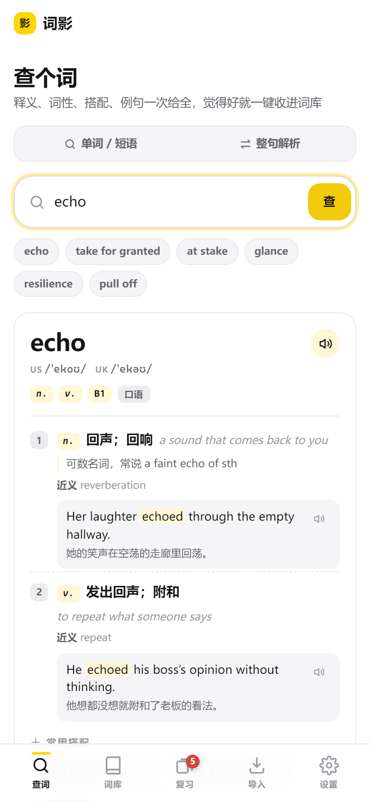
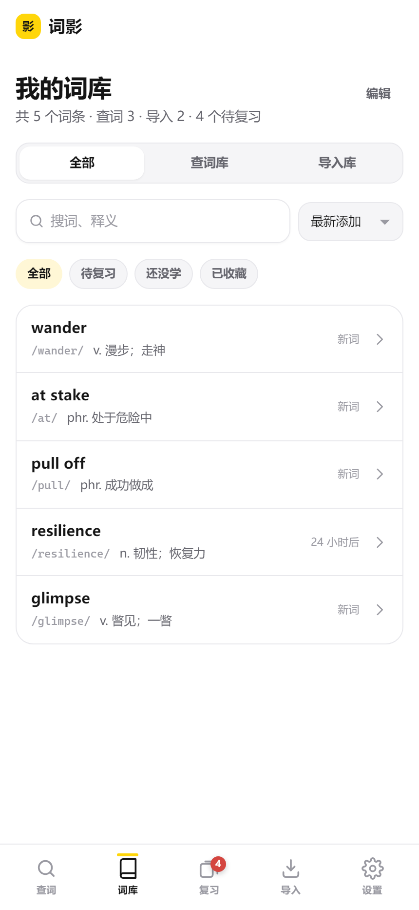
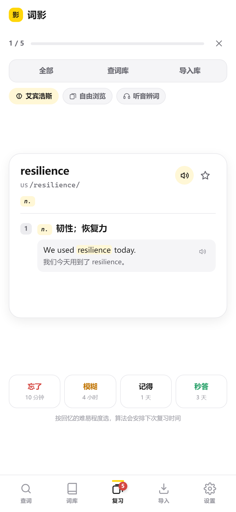
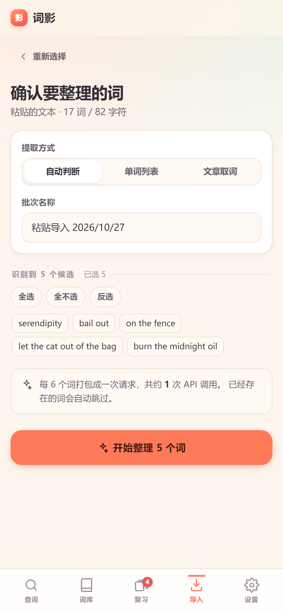
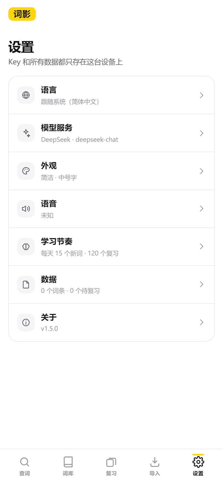
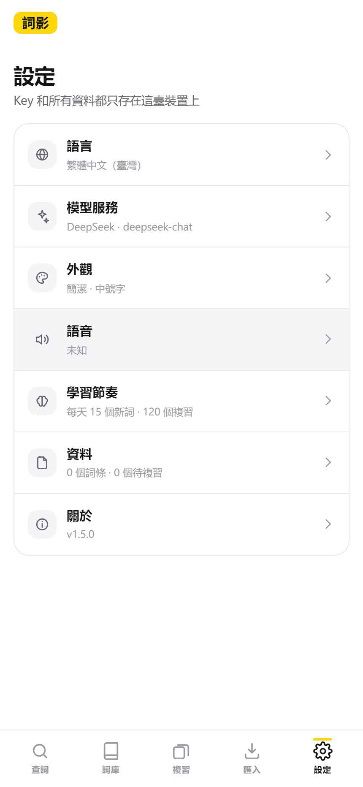
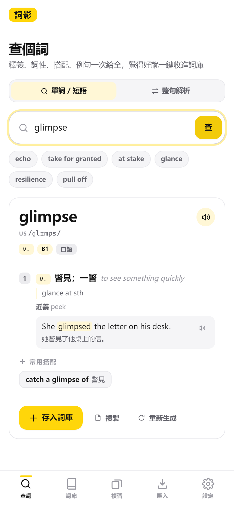
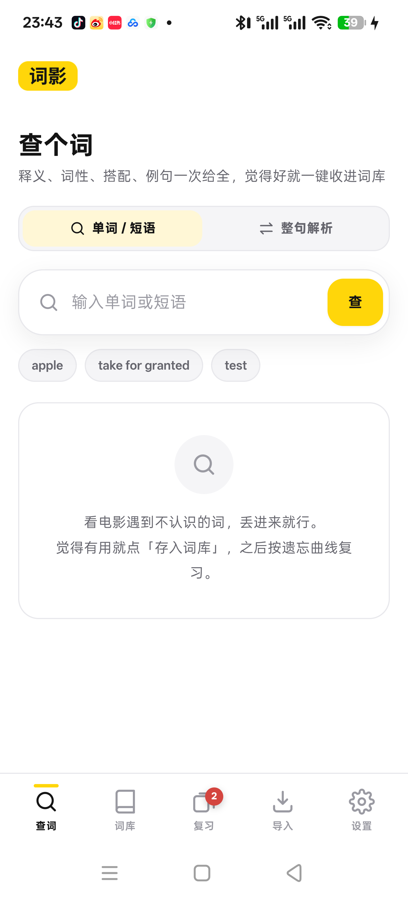
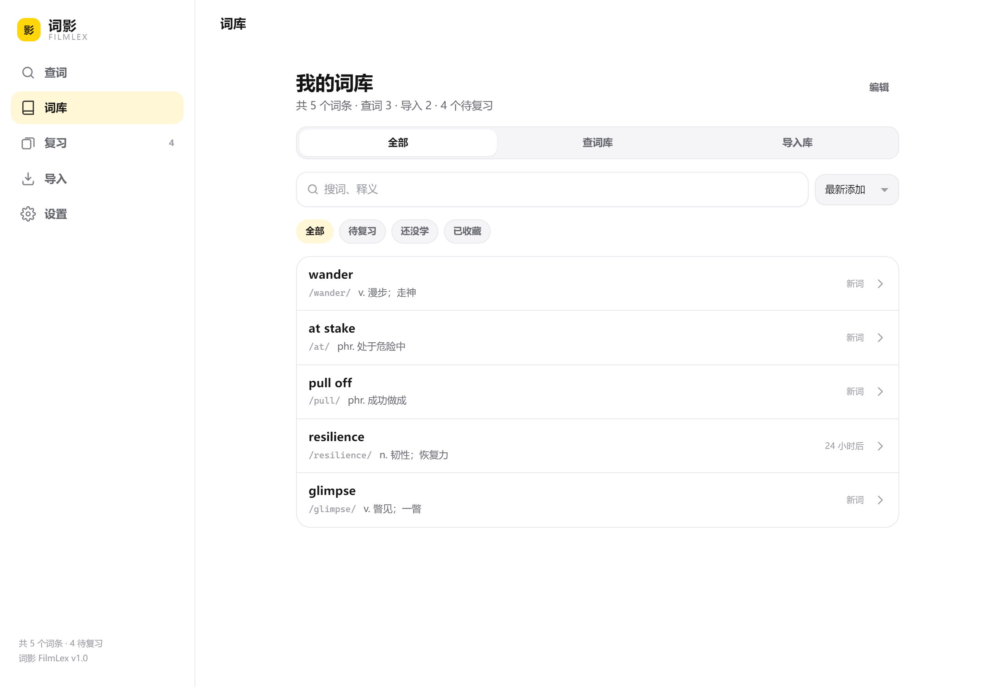

# 🎬 詞影 FilmLex (词影)

> **看電影、讀文章學英語：查詞 → 存入課本 → 按遺忘曲線高效複習。**
> 
> 📌 *本倉庫為 **詞影 FilmLex** 的官方產品展示與更新專頁（Product Showcase）。本產品為閉源商業/獨立開發項目，核心源代碼託管於私有倉庫。*

---

## 🌟 產品亮點

**詞影 FilmLex** 是一款結合 **離線優先大詞典** 與 **多模型 AI 深度解析** 的跨平台單字學習 App（支援 Android 與 Web / iPad）：

### 1. ⚡ 離線秒查 + AI 深度查詞
- **內置 12,917+ 核心詞彙離線大詞典**：涵蓋日常高頻、台灣學測/指考（7000 單）、四六級、考研、雅思、托福等 6 大官方考試詞庫，斷網也能秒出多詞性釋義與精選短例句。
- **AI 深度卡片**：支援接入 DeepSeek、Gemini、ChatGPT、Kimi、通義千問、智譜等主流模型，一鍵生成：
  - 音標（US / UK）、詞性、CEFR 難度分級
  - 按使用頻率排序的多義項（中英釋義、用法注記、近義詞）
  - 常用搭配、易混詞辨析、詞根詞綴記憶點、影視台詞風格例句

### 2. 🎞️ 影視字幕與整句解析
- 遇到看片或閱讀時不懂的長難句，直接貼上即可獲得：**字幕級中文翻譯 + 按語序切分的結構拆解 + 文法要點**。
- 句中值得記憶的單字與片語可一鍵單獨收入詞庫。
- 支援從 `.srt` / `.vtt` / `.ass` 字幕檔、`.pdf`、`.docx`、`.txt` 等格式批量提取生詞。

### 3. 📚 課本制管理與兩個書架
- **官方考試課本 & 自建課本**：自由切換當前學習課本，支援搜尋、排序、多維度篩選與批次合併。
- **防手滑安全設計**：支援批次勾選編輯與本地 JSON 完整備份，數據 100% 儲存在本地設備。

### 4. 🧠 艾賓浩斯 × SM-2 科學複習
- **三種複習模式**：
  - **艾賓浩斯考核**：「忘了 / 模糊 / 記得 / 秒答」四檔自評，按鈕即時預覽下次複習間隔（10 分鐘 → 4 小時 → 1 天 → 2.5 天… 動態難度係數遞增）。
  - **自由瀏覽**：純刷卡模式，按字母或順序輕鬆翻閱。
  - **聽音辨詞**：先聽發音回想釋義，訓練聽力反應。
- **專注模式**：複習時自動收起導航欄，進度即時落盤，中途退出下次無縫接續。

### 5. 🌏 原生簡繁雙語（台灣在地化用語深度適配）
- 支援 **跟隨系統 / 簡體中文 / 繁體中文（台灣）** 一鍵切換。
- 不只是字形轉換，更針對台灣英文教學與日常用語深度在地化（如：`文法`、`子句 / 關係子句`、`主詞 / 受詞`、`介系詞`、`假設語氣`、`片語`、`字根 / 字首 / 字尾`），AI 輸出的解析也會嚴格遵循台灣用詞習慣。

### 6. 🎨 四套精心打磨的主題
- 內置 **簡潔（暖陽） / 奶油 / 夜間 / 紙感** 四套主題，支援跟隨系統深淺色與三檔字號調節。

---

## 📱 界面預覽

| 查詞結果 | 詞庫管理 | 艾賓浩斯複習 |
|---|---|---|
|  |  |  |

| 批量匯入生詞 | 設定選單 | 夜間主題 |
|---|---|---|
|  |  |  |

| 繁體中文（台灣用語） | 繁體查詞卡片 | Android 實機運行 |
|---|---|---|
|  |  |  |

### 桌面與平板端（iPad / 電腦橫屏佈局）

---

## 📬 開發者與聯絡方式

這款 App 正在持續迭代打磨中，歡迎交流反饋或關注最新開發動態：

- **Threads**：[@dianziwang57](https://www.threads.net/@dianziwang57)（我有好點子）
- **Email**：cheche2021430@gmail.com

---

*Copyright © 2026 詞影 FilmLex. All Rights Reserved. (Proprietary & Closed-Source)*
